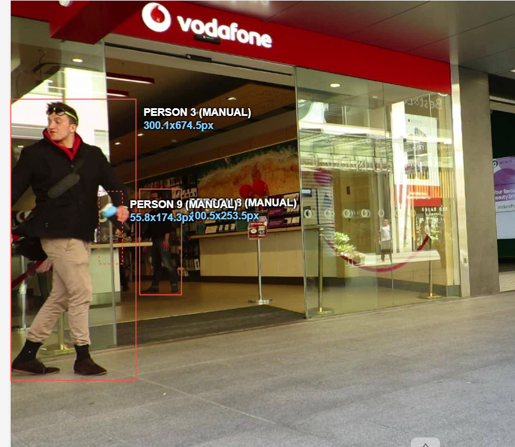
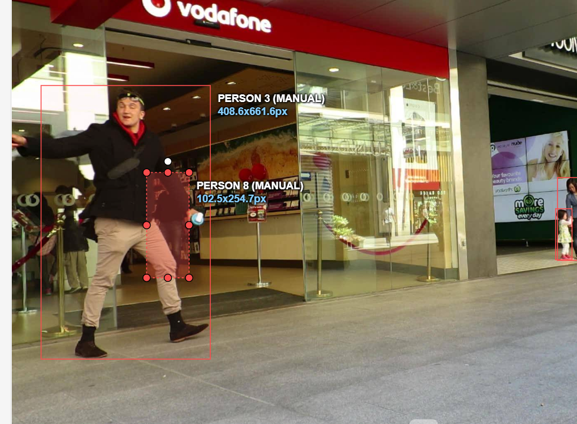
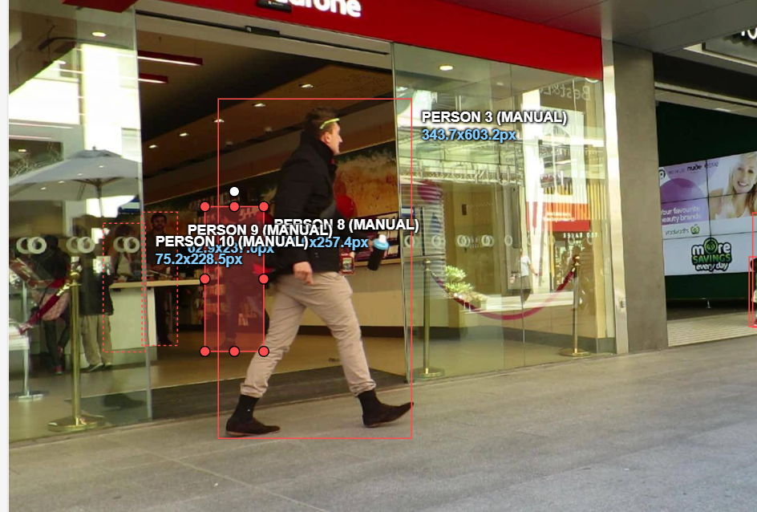

# Báo cáo cá nhân — NguyenNhatHa-2A202603325

Đổi tên file theo quy tắc `MSSV_HoTen.md`. Ví dụ: `20241234_NguyenVanAn.md`.

Đoạn video: MOT17-09, 150 frame (frame 1–150), nguồn MOTChallenge, giấy phép CC BY-NC-SA 3.0.

## 0. Thông tin học viên

- Họ tên: Nguyen Nhat Ha
- MSSV: 2A202603325
- Mã đề (A/B/C):A
- Email: hgnguyen47347714@gmail.com
- Link repository: https://github.com/hanguyen1406/K5-L2B-DAY05-NguyenNhatHa-2A202603325-MOTTracking
- Giờ bắt đầu: 18:00
- Giờ kết thúc: 20:00

## 1. Xem trước đoạn video (CP0)

Ghi **trước khi vẽ**, mỗi người một dòng.

Bài thực hành này được gán 10 người theo job thực tế trên CVAT. Các mã người và mốc xem trước cần đối chiếu trực tiếp với ảnh/video đã quan sát.

| Mã | Frame xuất hiện | Frame cuối thấy được | Rẽ / dừng / đổi tốc độ ở frame | Bị che ở frame | Ghi chú |
|---|---:|---:|---|---|---|
| Track 1 | 0 | 149 | [BỔ SUNG] | [BỔ SUNG] | [BỔ SUNG] |
| Track 2 | 0 | 149 | [BỔ SUNG] | [BỔ SUNG] | [BỔ SUNG] |
| Track 3 | 0 | 149 | [BỔ SUNG] | [BỔ SUNG] | [BỔ SUNG] |
| Track 4 | 0 | 128 | [BỔ SUNG] | [BỔ SUNG] | [BỔ SUNG] |
| Track 5 | 0 | 128 | [BỔ SUNG] | [BỔ SUNG] | [BỔ SUNG] |
| Track 6 | 0 | 149 | [BỔ SUNG] | [BỔ SUNG] | [BỔ SUNG] |
| Track 7 | 0 | 99 | [BỔ SUNG] | 30–49, 70–89 | [BỔ SUNG] |
| Track 8 | 50 | 149 | [BỔ SUNG] | [BỔ SUNG] | [BỔ SUNG] |
| Track 9 | 140 | 149 | [BỔ SUNG] | [BỔ SUNG] | [BỔ SUNG] |
| Track 10 | 142 | 149 | [BỔ SUNG] | [BỔ SUNG] | [BỔ SUNG] |

## 2. Keyframe và thời gian (CP1, CP4)

Số keyframe lấy từ kết quả `src/check_submission.py`.

| Mã | Số keyframe | Keyframe ở frame | Số frame có mặt | Keyframe / 100 frame | Thời gian (phút) | Chỗ khó |
|---|---:|---|---:|---:|---:|---|
| Track 1 | 21 | 0, 10, 20, 30, 40, 50, 60, 70, 79, 80, 90, 100, 109, 110, 119, 120, 129, 130, 139, 140, 149 | 150 | 14.0 | [BỔ SUNG] | [BỔ SUNG] |
| Track 2 | 17 | 0, 10, 19, 29, 39, 49, 59, 60, 69, 79, 89, 99, 109, 119, 129, 139, 149 | 150 | 11.3 | [BỔ SUNG] | [BỔ SUNG] |
| Track 3 | 17 | 0, 10, 20, 30, 40, 50, 60, 70, 80, 90, 100, 110, 119, 120, 129, 130, 140 | 150 | 11.3 | [BỔ SUNG] | [BỔ SUNG] |
| Track 4 | 2 | 140, 149 | 10 | 20.0 | [BỔ SUNG] | Track chỉ xuất hiện cuối đoạn |
| Track 5 | 7 | 142, 144, 145, 146, 147, 148, 149 | 8 | 87.5 | [BỔ SUNG] | Cảnh báo keyframe quá dày |
| Track 6 | 11 | 0, 9, 10, 29, 39, 49, 59, 69, 79, 99, 109 | 129 | 8.5 | [BỔ SUNG] | Có đoạn outside |
| Track 7 | 10 | 0, 10, 19, 29, 39, 49, 59, 69, 79, 99 | 129 | 7.8 | [BỔ SUNG] | Có đoạn outside |
| Track 8 | 14 | 0, 20, 30, 50, 60, 70, 80, 89, 99, 109, 119, 129, 139, 149 | 150 | 9.3 | [BỔ SUNG] | [BỔ SUNG] |
| Track 9 | 6 | 0, 10, 20, 50, 60, 90 | 60 | 10.0 | [BỔ SUNG] | Có nhiều lần outside |
| Track 10 | 8 | 50, 60, 80, 90, 110, 120, 130, 149 | 100 | 8.0 | [BỔ SUNG] | [BỔ SUNG] |
| **Tổng** | **113** | — | **1036** | **10.9** | — | 10 track |

Keyframe / 100 frame của cả bài = 113 ÷ 1036 × 100 = 10.9.

Bạn đặt keyframe nhiều nhất ở người nào? Vì sao (người đó rẽ, dừng, lại gần camera hay bị che)?

Track 1 có nhiều keyframe nhất (21 keyframe). Việc đặt keyframe dày hơn giúp bám theo chuyển động và thay đổi kích thước của người trong đoạn video.

## 3. Đoạn bị che (CP2)

Người bị che: `person 8` (cần xác nhận mã P1–P5 tương ứng)

Người che: `person 3`

| Mốc                                      |      Frame |
| ---------------------------------------- | ---------: |
| Bắt đầu bị che một phần (bật `occluded`) |         23 |
| Mất hẳn (bật `outside`)                  | Chưa cung cấp |
| Hiện lại (tắt `outside`)                 | Chưa cung cấp |
| Thấy rõ trở lại (tắt `occluded`)         |         53 |

- Ảnh trước khi che: frame 23.
- Ảnh giữa đoạn che: frame 29, bị `person 3` che.
- Ảnh sau khi hiện lại: frame 53.
- Thời gian khuất hẳn: chưa đủ mốc `outside` để tính chính xác.
- Quyết định: giữ cùng ID.
- Lý do: khoảng khuất cần được tính từ frame bật `outside` đến frame hiện lại. Nếu khoảng này không quá 60 frame và ngoại hình, hướng đi, tốc độ khớp thì giữ cùng ID. `person 8` vẫn là cùng người trước và sau khi bị `person 3` che, nên cần giữ object/ID cũ.

Giữ cùng ID giúp tracker hiểu đây vẫn là một người duy nhất, tránh `fragmentation` hoặc `id_switch` khi người đó xuất hiện lại.

Ảnh chụp màn hình:





## 4. Tự review ID (CP3)

Lượt 1 theo người (đi ngược từ frame 149 về 0 trên CVAT), lượt 2 theo cảnh (nhảy 10 frame). Ít nhất 3 dòng; không có lỗi thì ghi một dòng "đã kiểm hai lượt, không lỗi".

Loại lỗi dùng đúng một trong 7 mã: `id_switch`, `fragmentation`, `lost`, `merge`, `false_track`, `drift`, `flag`.

|     Frame | Mã người  | Loại lỗi  | Mô tả một câu | Phát hiện ở lượt | Đã sửa?   |
| --------: | --------- | --------- | ------------- | ---------------- | --------- |
| [BỔ SUNG] | [BỔ SUNG] | [BỔ SUNG] | [BỔ SUNG]     | [BỔ SUNG]        | [BỔ SUNG] |
| [BỔ SUNG] | [BỔ SUNG] | [BỔ SUNG] | [BỔ SUNG]     | [BỔ SUNG]        | [BỔ SUNG] |
| [BỔ SUNG] | [BỔ SUNG] | [BỔ SUNG] | [BỔ SUNG]     | [BỔ SUNG]        | [BỔ SUNG] |

Tổng hợp số lỗi theo loại:

| `id_switch` | `fragmentation` |    `lost` |   `merge` | `false_track` |   `drift` |    `flag` |
| ----------: | --------------: | --------: | --------: | ------------: | --------: | --------: |
|   [BỔ SUNG] |       [BỔ SUNG] | [BỔ SUNG] | [BỔ SUNG] |     [BỔ SUNG] | [BỔ SUNG] | [BỔ SUNG] |

Lỗi nào chỉ lượt 2 (theo cảnh) mới thấy, lượt 1 (theo người) không thấy? Vì sao?

Ở lượt 2 theo cảnh, có thể phát hiện lỗi mà lượt 1 bỏ sót vì lượt 2 nhìn đồng thời cả 5 box, đặc biệt tại thời điểm hai người đi sát hoặc che nhau. [BỔ SUNG ví dụ thực tế nếu có.]

## 5. File xuất và kết quả tự kiểm (CP4)

| Kiểm tra                                                  | Kết quả |
| --------------------------------------------------------- | ------- |
| Tên file MOT 1.1                                          | `NguyenNhatHa_mot.zip` |
| Tên file CVAT for video 1.1                               | `NguyenNhatHa_cvat_video.zip` |
| Số track ID khác nhau trong `gt/gt.txt`                   | **10** |
| Frame `outside` không có dòng trong `gt.txt` (đúng / sai) | Chưa đối chiếu riêng |
| Job đã completed trên CVAT máy cá nhân                    | Chưa xác nhận |

Dán phần tóm tắt in ra từ `src/check_submission.py`:

```text
Số frame in theo CVAT (bắt đầu từ 0). Trong gt.txt, frame_id = frame CVAT + 1.

=== File MOT 1.1: NguyenNhatHa_mot.zip ===
  Số track ID: 10   |   Tổng số box: 1036
  [OK]        Đúng 10 track ID.

  Track | Frame có mặt | Số frame | Đoạn vắng (outside)
      1 |   0–149      |      150 | -
      2 |   0–149      |      150 | -
      3 |   0–149      |      150 | -
      4 |   0–128      |      129 | -
      5 |   0–128      |      129 | -
      6 |   0–149      |      150 | -
      7 |   0–99       |       60 | 30–49, 70–89
      8 |  50–149      |      100 | -
      9 | 140–149      |       10 | -
     10 | 142–149      |        8 | -

  [CẢNH BÁO]  Track 10: chiều cao box đổi > 30% trong 1 frame ở frame [143, 144]. Kiểm tra box co giật (co box theo phần nhìn thấy?).

=== File CVAT for video 1.1: NguyenNhatHa_cvat_video.zip ===

  Track | Nhãn   | Frame thấy | Keyframe | KF/100 frame | Frame occluded | Lần bật outside
      0 | person |        150 |       21 |         14.0 |              0 |               0
              Track 0: keyframe ở frame [0, 10, 20, 30, 40, 50, 60, 70, 79, 80, 90, 100, 109, 110, 119, 120, 129, 130, 139, 140, 149]
      1 | person |        150 |       17 |         11.3 |              0 |               0
              Track 1: keyframe ở frame [0, 10, 19, 29, 39, 49, 59, 60, 69, 79, 89, 99, 109, 119, 129, 139, 149]
      2 | person |        150 |       17 |         11.3 |              2 |               0
              Track 2: keyframe ở frame [0, 10, 20, 30, 40, 50, 60, 70, 80, 90, 100, 110, 119, 120, 129, 130, 140]
      3 | person |         10 |        2 |         20.0 |              0 |               0
              Track 3: keyframe ở frame [140, 149]
      4 | person |          8 |        7 |         87.5 |              0 |               0
              Track 4: keyframe ở frame [142, 144, 145, 146, 147, 148, 149]
  [CẢNH BÁO]  Track 4: 88 keyframe / 100 frame > 50. Quá dày, dồn keyframe vào chỗ rẽ / dừng / bị che.
      5 | person |        129 |       11 |          8.5 |             20 |               1
              Track 5: keyframe ở frame [0, 9, 10, 29, 39, 49, 59, 69, 79, 99, 109]
      6 | person |        129 |       10 |          7.8 |             30 |               1
              Track 6: keyframe ở frame [0, 10, 19, 29, 39, 49, 59, 69, 79, 99]
      7 | person |        150 |       14 |          9.3 |              0 |               0
              Track 7: keyframe ở frame [0, 20, 30, 50, 60, 70, 80, 89, 99, 109, 119, 129, 139, 149]
      8 | person |         60 |        6 |         10.0 |             60 |               3
              Track 8: keyframe ở frame [0, 10, 20, 50, 60, 90]
      9 | person |        100 |        8 |          8.0 |             30 |               0
              Track 9: keyframe ở frame [50, 60, 80, 90, 110, 120, 130, 149]

  Tổng: 113 keyframe / 1036 frame có mặt = 10.9 keyframe / 100 frame
  [OK]        Đọc được 10 track từ annotations.xml.

=== Tóm tắt ===
  Lỗi: 0   |   Cảnh báo: 2
  Không có lỗi định dạng. Mở CVAT xem lại từng [CẢNH BÁO]; cảnh báo đúng ý bạn thì ghi lý do vào báo cáo.
```

## 6. Ba câu kết

1. Nếu được gán lại, bạn sẽ đặt keyframe khác ở đâu? Vì sao?

    Nếu được gán lại, em sẽ đặt thêm keyframe ngay trước khi `person 3` che `person 8`, tại frame 23, và ngay sau khi `person 8` hiện rõ trở lại ở frame 53. Em cũng sẽ kiểm tra kỹ Track 10 ở các frame 143–144 vì script phát hiện chiều cao box thay đổi hơn 30% trong một frame. Các keyframe này giúp giảm `drift` và giữ box bám sát người khi nội suy.

2. Có chỗ nào bạn không chắc "cùng ID hay ID mới"? Bạn đã quyết định và ghi chú thế nào?

    Em không chắc nhất ở đoạn `person 8` bị `person 3` che từ khoảng frame 23 đến frame 53. Em quyết định giữ cùng ID vì đây là cùng một người trước và sau khi bị che; thời gian khuất nằm dưới ngưỡng 60 frame của lớp, đồng thời hướng di chuyển và đặc điểm người vẫn liên tục. Khi còn thấy một phần người, em dùng cờ `occluded`; khi mất hẳn, em dùng `outside`; khi xuất hiện lại, em tắt `outside` và chỉnh lại box trên track cũ.

3. Một lỗi ID trong job của bạn (nếu không còn sót, chọn lỗi đã sửa) có thể làm xe tự lái dự đoán sai chuyển động của người đó như thế nào? Lỗi đó ảnh hưởng MOTA hay IDF1 nhiều hơn?

    Nếu xảy ra `id_switch`, hệ thống có thể hiểu người đó đột ngột biến mất rồi một người khác xuất hiện với ID mới, từ đó dự đoán sai hướng đi, vận tốc và quỹ đạo của người đó. Lỗi này ảnh hưởng IDF1 nhiều hơn vì IDF1 đánh giá khả năng duy trì đúng danh tính qua các frame. MOTA cũng bị giảm do có IDSW, nhưng MOTA còn phụ thuộc vào FN và FP nên không phản ánh đầy đủ việc giữ ID.

## Bonus (nếu làm)

### B1 — Hai người đi sát

...

### B2 — So cách đặt keyframe

| Cách đặt           | Số keyframe | Frame trôi nhất | Ghi chú |
| ------------------ | ----------: | --------------: | ------- |
| Đều mỗi 30 frame   |             |                 |         |
| Theo chỗ đổi hướng |             |                 |         |

...

### B3 — So với tracker có sẵn

| Frame | Mã người | Tracker làm gì | Nhãn của bạn | Giải thích (đoán rồi sửa / ghép IoU / box score thấp / ngoại hình) |
| ----: | -------- | -------------- | ------------ | ------------------------------------------------------------------ |
|       |          |                |              |                                                                    |
|       |          |                |              |                                                                    |

## 7. Tài liệu tham khảo và công cụ AI đã dùng

...
